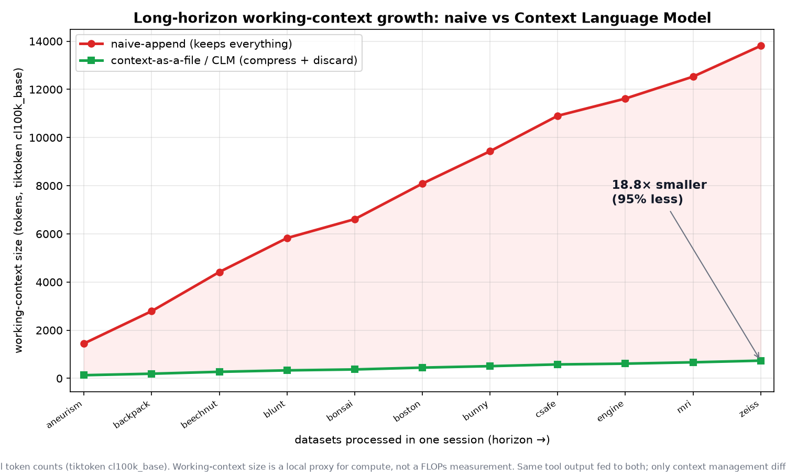

# I Taught a Visualization Agent to Manage Its Own Memory — Here's What a 2026 Meta Paper Taught Me

*How I implemented "Context Language Models" on my own ParaView agent, and watched its working memory stay flat while a naive agent's ballooned 15×.*

---

> **TL;DR** — I took the core idea from a new paper, *Context Language Models*
> (Shao et al., arXiv:2609.37725), and bolted it onto a side project of mine: a
> scientific-visualization agent that renders raw 3D volumes. The idea is simple
> and a little subversive — instead of letting an external harness decide what the
> model keeps in its context, you let the model **edit its own context as if it
> were a file**. On a long-horizon run across 11 real volume datasets, the
> self-managing agent held a working context **95% smaller** than a naive one, and
> the gap *widened* with every dataset I added. Here's the whole story, the code,
> and the honest caveats.

---

## The itch

I have a side project I'm quietly proud of: a *ParaView-style visualization agent
with persistent skill memory*. In plain terms, it's an AI agent that volume-renders
raw 3D scalar fields (think CT scans, engine blocks, bonsai trees reconstructed from
density data) and — this is the fun part — **writes down what it learned** from one
render so it doesn't repeat the same mistakes on the next one. That memory is just a
JSON file on disk. Lessons survive a restart. It's not fine-tuning; it's a notebook.

So when a friend pointed me at a brand-new paper out of Meta Superintelligence Labs
and UW — **Context Language Models** — I had the exact reaction you have when a paper
describes a more elegant version of a hack you already love.

## The paper, in one breath

A language model's **context** is its short-term working memory: the prompt, the
tool outputs, the half-finished reasoning. It fills up. Normally, *something outside
the model* — a hand-written "harness" — decides what to keep, summarize, or throw
away.

The paper's move: **stop doing that.** Give the model its context **as a file it can
freely rewrite** — delete stale lines, compress a 300-line tool dump into a one-line
fact, reorganize by importance — and sync every edit straight back into its live
context. A normal model can only *append*. A **Context Language Model (CLM)** can
*rewrite*.

Their headline result is the thing that made me sit up: it's not just more accurate,
it's **cheaper** — better scores at *fewer* FLOPs, because the model stops lugging
around useless tokens. On a 24-hour, six-repository agent-swarm task, they report a
65% greater improvement at the same compute.

(The paper also has an RL method and a serving-cache trick. I deliberately left those
alone — more on that below.)

## My bet

My project already treats *long-term memory* as a file. The paper treats
*working memory* as a file. They're complementary: one carries lessons **across**
tasks, the other manages the context **within** a task. So the question wrote itself:

> If my agent managed its own working context as a file — compressing each dataset's
> bulky inspection output into a single resolved fact — would its working memory
> actually stay small on a long run, the way the paper claims?

To find out, I needed a **long-horizon** task, because that's where the effect lives.
One or two datasets won't show it. A long batch will.

## What I built

I kept everything in a self-contained `CLM/` folder (on its own git worktree, so my
main project stayed clean):

- **`context_store.py`** — the mechanism. A working-context Markdown file the agent
  edits with four operations: `append` (what a naive model does), plus `set` /
  `discard` / `compress` (the rewriting a CLM does). Standard-library only.
- **`manage-context` skill** — a prompt-skill that tells the agent, after each
  inspect/render step, to rewrite its working file: keep the resolved facts (dtype,
  scalar range, cutoff, current transfer function), discard the raw dumps, log what
  it threw away.
- **`clm_metrics.py`** — measures working-context size over a run (my honest local
  stand-in for the paper's FLOPs axis).
- **`longhorizon.py`** — the experiment: process **every** `.raw` volume in `data/`
  in **one continuous session**, two ways:
  - **naive-append** — one context that grows across every dataset, nothing discarded;
  - **context-as-a-file (CLM)** — compress each dataset to one resolved fact, discard
    the bulk, carry a tiny running summary.

For each dataset it does *real* work: reads the actual bytes, resolves the dtype and
dimensions (from the filename when encoded, e.g. `backpack_512x512x373_uint16`,
validated against the byte count), and measures the true scalar range. Where the
volume is small enough, it even writes a real VTK render.

## The result

I dropped **11 real volume datasets** into `data/` — a nice spread, from a 2 MB blunt
fin to a 3.24 GB beechnut CT scan — and ran it. Here's the working-context size,
in **real tokens** (counted with `tiktoken`'s `cl100k_base` BPE tokenizer — the
same kind of count a GPT-class model actually sees), after each dataset:



*Naive-append (red) keeps everything and grows roughly linearly; the CLM
context-as-a-file agent (green) compresses and discards, so it stays nearly flat.
Same tool output fed to both — only the context management differs. The shaded gap
is the working memory the CLM agent never had to carry.*

The same numbers as a table:

```
after file                          naive    CLM   gap
aneurism_256x256x256_uint8           1449    132   11.0×
backpack_512x512x373_uint16          2792    194   14.4×
beechnut_1024x1024x1546_uint16       4416    273   16.2×
blunt_fin_256x128x64_uint8           5826    333   17.5×
bonsai                               6611    371   17.8×
boston_teapot_256x256x178_uint8      8087    447   18.1×
bunny_512x512x361_uint16             9431    508   18.6×
csafe_heptane_302x302x302_uint8     10903    579   18.8×
engine                              11618    612   19.0×
mri_woman                           12529    668   18.8×
zeiss_680x680x680_uint8             13808    736   18.8×

End of horizon: naive 13808 tokens vs CLM 736 tokens
→ CLM is 94.7% smaller, 18.8× less.
```

Look at the two trajectories. The **naive** agent climbs in a straight line — 1449,
2792, 4416… — because it never lets go of anything. The **CLM** agent barely moves:
132, 194, 273… It read exactly the same bulky inspection output; it just refused to
keep it.

The punchline isn't the final percentage. It's the **shape**: the naive line grows
roughly linearly with the number of datasets, while the CLM line stays nearly flat.
So the advantage **compounds** — 11× smaller after one dataset, 18.8× after eleven.
Every file I added widened the gap. *That* is what "long-horizon" means, and it's
exactly the behavior the paper describes.

Peek inside the CLM agent's working file at the end and it's almost comically tidy —
a handful of lines, one resolved fact per volume:

```
## Resolved facts
- bonsai: uint8 256x256x256, range [0,255]; bg cutoff ~15%, dense core opaque
- engine: uint8 256x256x128, range [0,255]; bg cutoff ~15%, dense core opaque
- mri_woman: uint16-le 256x256x109, range [2,4095]; bg cutoff ~15%, dense core opaque
  ...
## Discard log
- [bonsai] compressed 63 lines -> 1 fact
- [engine] compressed 63 lines -> 1 fact
  ...
```

Eight lines of signal where the naive agent kept 199 lines of mostly noise.

## Why this works (the intuition)

Transformer attention cost grows **super-linearly** with context length — roughly
quadratically. So a working context that's ~19× smaller isn't ~19× cheaper, it's
potentially *much* more than that per step, and it buys you headroom to run far
longer before you hit a context wall. The naive agent isn't just wasteful; on a
genuinely long task it eventually **can't continue**. The CLM agent could keep going
across dozens more datasets without breaking a sweat.

The deeper lesson is the paper's, and it echoes Rich Sutton's *Bitter Lesson*: don't
hand-code the memory strategy. Give the model the ability to manage its own context
and let a better strategy emerge. My tiny experiment is a toy, but it points the same
direction.

## The honest caveats (because I'd want them)

I'm a fan of this idea, which is exactly why I want to be precise about what I did
*not* prove:

1. **Real token counts, but size is still a proxy for compute.** The token numbers
   above are now *real* — counted with `tiktoken`'s `cl100k_base` BPE tokenizer, the
   same kind of count a GPT-class model sees (the code falls back to a chars/4
   estimate only if `tiktoken` isn't installed). What's still a stand-in is the leap
   from *token count* to *FLOPs*: I can't count real server FLOPs on my setup.
   Context size is directionally meaningful (see the super-linear point above), and
   token counts are tokenizer-specific — so the absolute numbers shift between
   models, but the naive-vs-CLM **ratio** is what's robust, and that's the headline.
2. **I implemented one of the paper's three contributions.** I built the
   "context-as-a-file" mechanism. I deliberately skipped their reinforcement-learning
   method (needs model-weight access) and their Suffix-Cache-Reuse serving trick
   (needs a custom inference server). Those aren't things my project can host, and I
   won't pretend otherwise.
3. **The render steps are modeled, not a live LLM agent loop.** The *inspection* of
   each volume is real (real bytes, real ranges, real renders). The accumulation of
   "tool output" is a faithful simulation of what an agent would receive, so the
   context-management comparison is apples-to-apples — but it's a controlled harness,
   not a wild agent transcript.
4. **One run per condition.** This is a demonstration, not a statistically powered
   benchmark.

None of these dent the core observation: *rewriting your context instead of appending
to it keeps working memory flat on a long task, and the benefit compounds.*

## Try it yourself

The whole thing is a few hundred lines of dependency-light Python. The loop is:

```bash
# optional: real BPE token counts (else it falls back to a chars/4 estimate)
pip install tiktoken

# drop any number of .raw volumes into data/, then:
python3 CLM/longhorizon.py --render
python3 CLM/clm_metrics.py --compare \
    CLM/context/longhorizon_naive.json CLM/context/longhorizon_clm.json
```

Add more datasets, re-run, watch the gap widen. That's the experiment.

## What's next

A few threads I want to pull:
- **A real plot** of the two growth curves (the table practically draws itself).
- **Wiring the CLM working file into the live agent loop**, so a real session —
  not a modeled one — manages its own context mid-task.
- **An automated image-quality check**, so "did the render actually come out right?"
  is scored, not eyeballed.

If you've read the CLM paper and think I've mischaracterized anything, I genuinely
want to hear it — reply and tell me where I'm wrong.

---

*Code and artifacts live in the `CLM/` folder of my ParaView visualization-agent
project. The paper is [Context Language Models, Shao et al., arXiv:2609.37725](https://arxiv.org/abs/2609.37725).*

<!--
SUBSTACK NOTES (delete before publishing):
- Suggested subtitle: "A small experiment with a big, compounding result."
- Images to attach: the growth-curve chart is already embedded in the "result"
  section (CLM/context/longhorizon_growth.png). Optionally add a VTK render
  (e.g. results/mri_woman_longhorizon.png) as the header image.
- All numbers above are from a real run on 11 volumes — keep them in sync if you
  re-run with more datasets.
- Length ~1,400 words; trim the caveats section if you want a punchier read.
-->
