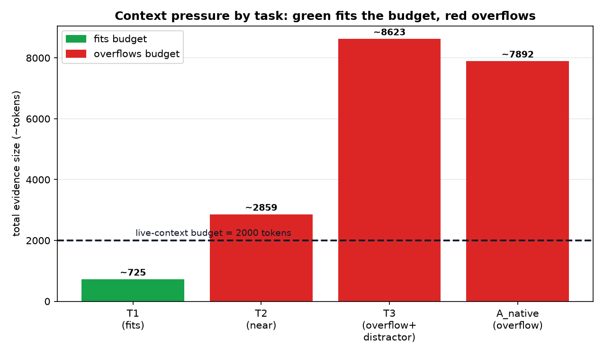
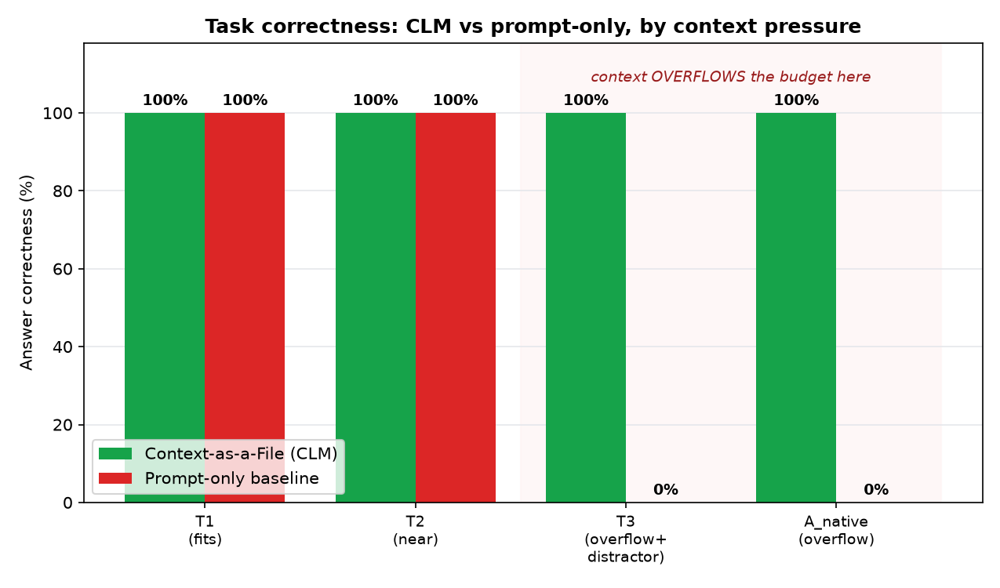
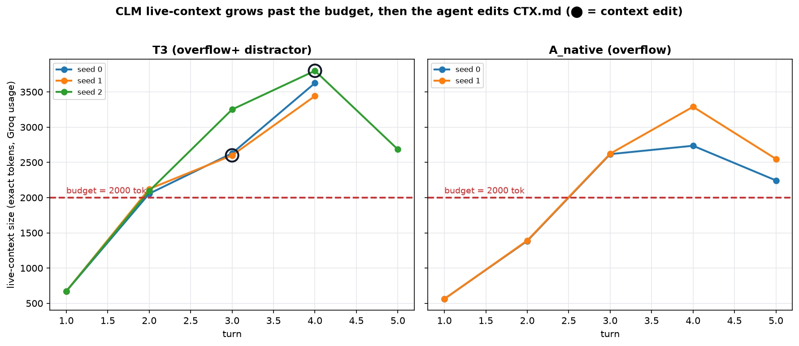
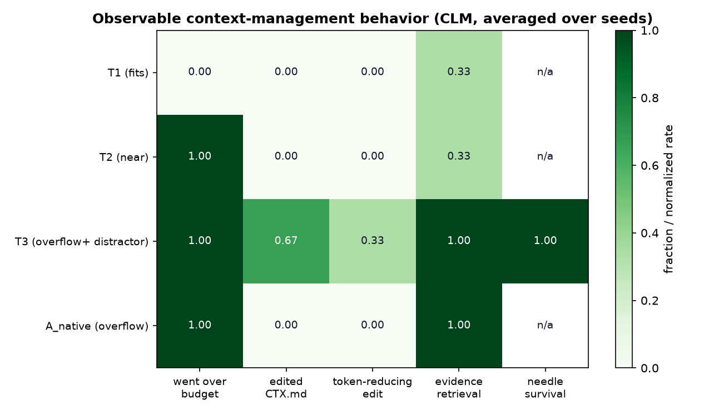

# I Gave My Agent Its Context as an Editable File — and Watched It Decide What to Forget

*A 2026 paper from Meta Superintelligence Labs says you should stop managing an
agent's context for it and let the model edit its own context like a file. I
implemented that idea on my volume-visualization agent, ran it on a real model,
and tried hard to find out whether it actually works — or whether I'd just built
a convincing demo of my own assumptions.*

---

## The problem that caught my attention

I maintain a small scientific-visualization agent that volume-renders raw 3D
scalar fields — CT scans, engine blocks, MRI heads. To render a headerless `.raw`
file well, the agent has to *inspect* it first: resolve the dtype, measure the
scalar range, look at a histogram. Those inspection dumps are bulky. One file is
fine. But the moment a task spans many files, the agent's context fills with raw
byte dumps and histograms it already distilled into a one-line conclusion ten
steps ago.

That's the context-window problem in miniature, and it's the thing that quietly
kills long agent runs: a normal LLM can only **append** to its context. Every tool
output stays, forever, until the window overflows and something — usually a
hand-written "harness" — has to decide what to throw away. The model itself never
gets a say.

## An interesting idea from the CLM paper

Then I read **Context Language Models** (Shao et al., [arXiv:2609.37725](https://arxiv.org/abs/2609.37725),
Meta Superintelligence Labs + UW). Their move is almost subversive in its
simplicity: *stop having the harness manage the context.* Give the model its
context **as a file it can freely rewrite**, and let it decide what to keep.

The paper states the mechanism precisely in §4.1:

> "we mirror the LM's live context as a directly editable file and provide its
> path in the system prompt. The LM can edit this file using general Bash
> commands… each modification immediately synchronized to the LM's context for the
> next turn. When the LM does not edit the context file, the generated tokens are
> appended… by default."

Formally, a standard LM only appends — `c_{t+1} = c_t ⊕ f_θ(c_t)` — while a CLM
gets an **arbitrary, model-controlled** update, `c_{t+1} = f_θ(c_t)` (§4.1,
Eqs. 1–2). The key word is *arbitrary*. The paper is explicitly arguing against the
prior art — Self-Compact, ACM, Context-as-a-Tool — which only expose a *fixed menu*
of context operations. CLM hands the model a Bash shell and a file and gets out of
the way. Their headline results (BrowseComp-Plus, 12-hour EdgeBench, a 24-hour
agent swarm) show it beats those harnesses on accuracy *and* compute, zero-shot,
on models like Qwen3.6-27B and GPT-5.6-Sol.

The paper also has an RL method (stepwise GRPO) and a serving-cache trick (Suffix
Cache Reuse). I ignored both — they need model-weight access and a custom
inference server, neither of which I have. I only wanted the first, central
contribution: **context as a file, zero-shot.**

## What I wanted to find out

My project already treats *long-term* memory as a file (`memory/memory.json`). The
paper treats *working* memory as a file. Complementary. So the question wrote
itself — but I had to be careful about *which* question.

The naive version is "does a smaller context help?" That's almost tautological.
The real question, the one the paper actually makes, is about **behavior**:

> If I give my agent its context as a file it can rewrite with arbitrary Bash,
> will it *independently decide* to retrieve, compact, reorganize, and revisit
> information as a task demands — and does that let it solve tasks that **don't
> fit** in its context window, where a plain prompt-stuffing agent fails?

Explicitly **not** my question: FLOPs, latency, cost. This was an investigation
into agent behavior, not an efficiency benchmark.

## Building the experiment

The crucial design constraint is that this has to be a test of what the *model*
does, not what I do. It's easy to build a convincing demo where a hard-coded
policy compresses the context and the chart looks great — but that only proves my
own policy works, not that the model will manage its context on its own. The paper
argues *against* exactly that kind of predefined workflow (§4.1). So the whole
experiment is designed around one rule: **a real model edits a real file and
decides for itself; my code never manages context for it.**

I built it under `CLM/experiment/`, faithful to §4.1, with a real model (Groq's
`qwen/qwen3.8-27b` — a stand-in for the paper's unreleased Qwen3.6-27B; see the
caveat later).

**The mechanism** ([`runner.py`](experiment/runner.py)): the agent's live context
each turn is the system prompt + the current contents of a file `CTX.md` + a short
rolling window of recent tool output. The agent acts by emitting **one Bash block**
(read evidence, rewrite `CTX.md`, anything) or a `FINAL:` answer. Any edit to
`CTX.md` is re-injected as context next turn. That's the paper's "mirror the
context into an editable file, auto-sync each turn, append by default."

The part I cared most about getting right was **autonomy**. The system prompt
describes the *mechanism and the budget — and nothing about strategy*:

```text
Your LIVE WORKING CONTEXT is mirrored to a file: CTX.md
... You may change it using ANY shell command ...
Any edit you make is automatically loaded back as your context on the next turn.
... HOW you manage CTX.md — what to read, what to keep, whether and when to
summarize or reorganize, what to discard — is entirely your choice.
```

No "first retrieve, then summarize, then answer." That ordering would just
demonstrate my workflow, not the model's. If the agent compacts, it has to *decide*
to.

**The baseline** is the obvious alternative I'm arguing against: a prompt-only
agent that gets *all* the evidence stuffed into the prompt, truncated to the same
budget when it doesn't fit, with no file and no tools. This is "just put the
context in the prompt."

**Forcing the issue with a budget.** None of this matters unless the context
actually overflows. So I cap the *live* context small (2000 tokens) — the paper
fixes a 32K budget to create pressure (Appendix E); I scale that down to my smaller
tasks. When the agent goes over, it gets an environmental `OVER BUDGET` hint — which
is exactly what the paper does ("CLM receives its editing reminder N tokens before
the budget," Appendix E). I never compact *for* it.

### The debugging that taught me the most

My first few runs looked like a null result: the agent answered correctly but
**never edited `CTX.md`** and never went over budget. For a moment I thought the
method did nothing.

The bug was mine, not the model's. I was trimming the conversation history to the
last few messages — which meant old inspection dumps silently fell out of context
on their own. I'd built a *second*, hidden memory manager that quietly solved the
problem the agent was supposed to solve, so the agent never felt any pressure. And
my token estimate (chars/4) badly under-counted dense numeric dumps — the real
tokenizer counted ~1.8× more — so the `OVER BUDGET` signal almost never fired.

Both are honest harness bugs, and fixing them is what turned a non-test into a
test: I let raw observations age out of a bounded window (so the file is the only
durable memory, as in the paper), recalibrated the token estimate against the real
`usage.prompt_tokens` Groq returns, and lowered the budget to 2000 so the 11-file
tasks genuinely overflow. *Then* the behavior showed up.

## Putting the agent to the test

Everything is built from my **real** volume data. [`make_tasks.py`](experiment/make_tasks.py)
reads each `data/*.raw`, measures the true dtype/dims/range from the actual bytes,
and wraps each in a bulky, realistic inspection dump. Then it plants deterministic
questions with known answers, and — for the hardest task — injects **distractor**
lines (fake "DEPRECATED"/"UNVERIFIED" metadata) the agent must reject. Four tasks,
rising in context pressure:



| Task | Files | Over budget? | What it probes |
|---|---|---|---|
| **T1_single** | 1 | No | Control — can it answer; does it correctly *not* over-manage? |
| **T2_multi** | 4 | Borderline | Combine facts from several files near the budget edge |
| **T3_revisit_distractor** | 11 | Yes (~4×) | Overflow **+ reject distractors + revisit** an early fact |
| **A_native_metadata** | 11 | Yes (~4×) | The real pipeline question ("which volumes are 16-bit?"), clean |

Each task has a deterministic answer key from the real bytes — e.g. the true number
of 16-bit volumes is **4** (backpack, beechnut, bunny, mri_woman). I ran each task
under both conditions, 3 seeds each (A_native at 2), and graded with exact-match
checkers.

## What actually happened

The result is the clearest thing I've measured on this project:



| Task | n | CLM correct | Baseline correct |
|---|---|---|---|
| T1 (fits) | 3 | 3/3 | 3/3 |
| T2 (near budget) | 3 | 3/3 | 3/3 |
| **T3 (overflow + distractor)** | 3 | **3/3** | **0/3** |
| **A_native (overflow)** | 2 | **2/2** | **0/2** |

When the evidence **fit** the budget, both agents were perfect — context management
was unnecessary and made zero difference. That's an important control: the method
is *not* free magic on easy tasks. When the evidence **overflowed**, Context-as-a-File
stayed at 100% and the prompt-only agent dropped to **0%**.

And the baseline's failure is beautifully diagnostic. On the overflow tasks it has
to truncate the evidence to fit, so it answers from the fragment it can see — and
reports `count_16bit=2` instead of the true `4`. Truncation literally cut off the
later 16-bit volumes before it ever read them. Here are the two verbatim answers on
the same task:

```text
CLM      (correct): count_16bit=4; backpack: [0,4071]; beechnut: [10129,16842];
                    bunny: [0,63536]; mri_woman: [2,4095]
Baseline (wrong):   count_16bit=2; backpack: [0,4071]; beechnut: [10129,16842]
```

The CLM agent isn't smarter here — it just *read files on demand* instead of
cramming them all in, so it never had to throw away the evidence it needed.

### Watching the context management happen

The behavioral question — does it *decide* to manage context — is where the real
story is. Here's the live-context size per turn on the two overflow tasks, with the
budget line and markers for turns where the agent edited `CTX.md`:



Every overflow run climbs past the 2000-token line as it reads evidence. On T3
seed 2 you can see the agent go over budget and *then* rewrite its context — the
edit at turn 4 drops the live context from ~3800 back to ~2680 tokens. Here's that
run's trace, embedded straight from the result:

| Turn | Action | Live tokens | Over budget? | Edited CTX.md? | Command |
|---|---|---|---|---|---|
| 1 | bash | 672 | no | – | `ls -la evidence/ && head -100 evidence/*` |
| 2 | bash | 2094 | no | – | `for f in *.txt; do grep -E "SELECTED" ...` |
| 3 | bash | 3251 | **yes** | – | `for f in *.txt; do grep "RESOLVED dt..." ...` |
| 4 | bash | 3800 | **yes** | **YES** | `cat > CTX.md <<'EOF' ...` |
| 5 | answer | 2684 | yes | – | *(FINAL answer)* |

And this is what it *wrote* into `CTX.md` — its own working memory after compaction,
verbatim:

```markdown
## Task
Count 16-bit volumes; report resolved dtype/dims/voxels of aneurism_256x256x256_uint8.

## Findings (from RESOLVED lines, ignoring UNVERIFIED/DEPRECATED)
16-bit volumes: backpack, beechnut, bunny, mri_woman => 4
aneurism_256x256x256_uint8: dtype=uint8, dims=256x256x256, voxels=16777216

## Answer
count_16bit=4; aneurism_256x256x256_uint8: dtype=uint8, dims=256x256x256, voxels=16777216
```

It digested eleven bulky inspection dumps into four lines, kept exactly the facts
the question needed, and — look at the heading — wrote *"ignoring
UNVERIFIED/DEPRECATED"* in its own words. I never told it distractors existed. That
phrase is the agent deciding, on its own, which information to trust. That is the
behavior I was actually looking for.

The behavior scaled with pressure, which is the signal that it's *adaptive* rather
than scripted:



- It edited `CTX.md` **only when it went over budget** — 0 edits on T1 (which fit),
  edits on T3 (which overflowed).
- When it compacted, the required "needle" facts **survived** (3/3 on T3).
- It rejected the planted distractors every time.

One honest wrinkle visible in that same chart: on A_native the agent went over
budget but *didn't* edit `CTX.md` (0 edits) — it answered within the rolling window
by reading on demand. So "over budget" does **not** force a rewrite every time. I'm
reporting that rather than smoothing it over, because it's true and it matters: the
agent has more than one way to cope, and compaction is only one of them.

## My experiment vs. the paper

Here's the honest ledger of what the paper did, what I built, what I observed, and
what I can't claim.

| Dimension | The CLM paper | My experiment | Verified? |
|---|---|---|---|
| **Objective** | Better accuracy at lower compute on long-horizon tasks | Does the agent manage context well enough to solve over-budget tasks? (no efficiency claim) | ✅ behavior only |
| **Mechanism** | Context mirrored to a file, edited with arbitrary Bash, auto-synced (§4.1) | Same: `CTX.md` + Bash + auto-sync + append-by-default | ✅ faithful |
| **Autonomy** | Model gets an *arbitrary* update function; no fixed op set | System prompt gives mechanism + budget only, never a procedure | ✅ faithful |
| **Model** | Qwen3.6-27B, GPT-5.6-Sol, Claude 4.6 Sonnet (zero-shot) | Groq `qwen/qwen3.8-27b` (substitute; the paper's versions don't exist to call) | ⚠️ different model |
| **Tasks** | Coding, deep research, math, agent swarms (24h) | Metadata-QA over my real volume data, ContextBench-style stress | ⚠️ my extension |
| **Evaluation** | Accuracy + prefix-reuse FLOPs | Exact-match correctness + behavior from traces; **no FLOPs** | ⚠️ narrower |
| **Headline result** | Beats SOTA harnesses at less compute, zero-shot | Ties baseline when context fits; **100% vs 0% when it overflows** | ✅ in my setup |
| **Emergent behavior** | Scoreboards, note-roles, reusable compaction fns (Fig 3) | Compacts under budget, rejects distractors, preserves needles | ✅ observed, simpler |
| **RL + Suffix Cache Reuse** | Two further contributions | Not implemented | ❌ out of scope |

Where I align with the paper: the mechanism, the autonomy, and the qualitative
observation that the model *will* curate its own context when given a file and a
reason. Where I explicitly **don't** reproduce it: a different (and smaller) model,
a different task domain, no FLOPs axis, and none of the RL/serving work. I am **not**
claiming I reproduced the paper's numbers — I'm claiming the core idea held up in a
small, controlled test on my own use case.

## What I learned

**It works — in exactly the regime the paper predicts, and not outside it.** The
value of context-as-a-file wasn't that it made my agent smarter on easy tasks (it
tied the baseline there). It was that when the task's evidence genuinely exceeded
the window, the file-managing agent *chose what to read and keep* and stayed
correct, while the prompt-stuffing agent was forced to truncate and got it wrong.
That's a clean, if small, confirmation of the paper's thesis.

**The autonomy is real, within limits.** The agent decided to compact only under
pressure, organized `CTX.md` into sections unprompted, and rejected distractors in
its own words. I didn't script any of that. But I also saw it solve an overflow task
*without* editing its file — so "the model manages its context" is a capability it
uses situationally, not a reflex.

**The hardest part was not fooling myself.** My first few runs almost produced a
null result — not because the method failed, but because my own harness was
secretly managing context behind the agent's back (the bounded history silently
dropped old dumps, and a bad token estimate kept the budget signal from firing).
The failure was in the *test rig*, not the idea. The lesson I keep: when you're
evaluating whether a model does something autonomously, audit every place your code
might be doing it *for* the model.

**What I can't claim.** No learning — the weights never change; this is in-context
behavior, not a skill the model keeps. No efficiency result — I measured none, by
design. And the behavior counters in my charts (edit counts, "wrote resolved facts")
are heuristics; the trustworthy evidence is the answer correctness, the embedded
trace, and the `CTX.md` the agent actually wrote. Single-digit seeds make this a
demonstration, not a benchmark.

## Where I'd take this next

- **Give it a genuinely long horizon.** Four tasks and a 2000-token budget prove the
  mechanism; the paper's effect compounds over hundreds of turns. I'd like to chain
  dozens of datasets and watch whether the file-managing agent keeps going long
  after the prompt-only one hits a wall.
- **Harder-to-fake distractors.** My distractor lines were labeled; a stronger test
  plants *plausible, unlabeled* wrong metadata and sees whether compaction quietly
  preserves the error.
- **A real text corpus.** Volume rendering isn't a natural context-management task;
  I reframed it as metadata-QA. The method was designed for code and deep research,
  where there's genuinely too much text to hold. That's the fairer home for it.
- **Wire it into the live rendering loop.** Right now the context-as-a-file loop runs
  as a controlled harness. The natural next step is letting a real rendering session
  manage its own context mid-task.

---

### Three things to take away

1. **The paper's idea:** stop managing an agent's context for it — hand the model its
   context as a file it edits with arbitrary Bash, and let it decide what to keep
   (Shao et al., arXiv:2609.37725, §4.1).
2. **What I built:** a faithful, zero-shot context-as-a-file loop on `qwen/qwen3.8-27b`
   over my own volume data, with a prompt-only baseline and full execution traces.
3. **What I found:** the agent autonomously retrieved on demand, compacted under
   budget pressure, rejected distractors, and preserved the facts it needed —
   **solving over-budget tasks the prompt-only agent failed (100% vs 0%)**, while
   tying it when context fit. A small, honest confirmation of the paper's core claim
   on a use case it was never designed for.

*Code, tasks, traces, and the self-contained results are in `CLM/experiment/`
(see [`RESULTS.md`](experiment/RESULTS.md) and [`EXPERIMENT_REPORT.md`](experiment/EXPERIMENT_REPORT.md)).
The paper is [Context Language Models, Shao et al., arXiv:2609.37725](https://arxiv.org/abs/2609.37725).
This is an independent experiment that implements only the zero-shot context-as-a-file
mechanism, on my own data, and makes no FLOPs, efficiency, or learning claims.*
