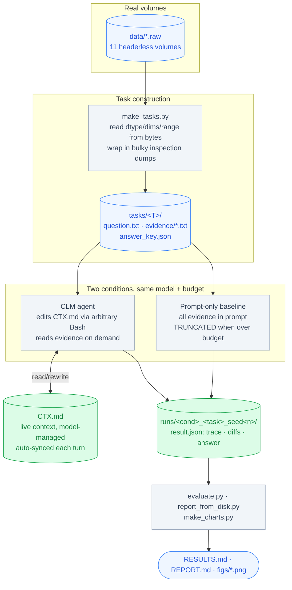
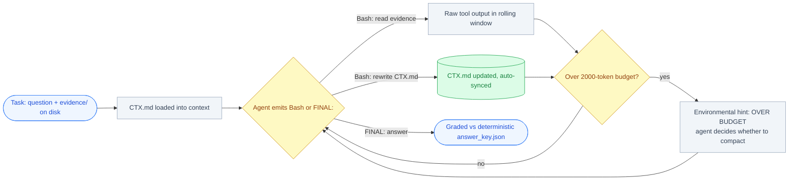

# Context-as-a-File — A Behavioral Experiment on the Volume-Visualization Agent

**A faithful, zero-shot reproduction of the "context as a file" mechanism from *Context Language
Models* (Shao et al., arXiv:2609.37725, §4.1), run against a plain prompt-only agent on tasks built
from this repository's real `data/*.raw` volumes — to test whether letting a model manage its own
context as an editable file beats cramming everything into the prompt.**


-brightgreen)


> **Companion write-up:** I describe the motivation, the paper's idea, and what this experiment found
> in plain language in my Substack article —
> **[Does "Context as a File" actually work? (Ramya Lakshmi KS, Substack)](https://substack.com/@ramyalakshmiiks/p-22041492)**.
> This README is the reproducible, artifact-backed version of that story.

> **What this is / is not:** this reproduces the **zero-shot context-as-a-file mechanism only** — the
> model's live context is mirrored to an editable `CTX.md` it rewrites with arbitrary Bash. It makes
> **no FLOPs, efficiency, or learning claims**, and it does **not** reproduce the paper's reinforcement
> learning or Suffix-Cache-Reuse serving contributions. Those are out of scope and explicitly not
> claimed.

---

## Table of Contents

- [Demo and Artifacts](#demo-and-artifacts)
- [The Problem and Research Objective](#the-problem-and-research-objective)
- [What the Paper's Method Actually Is](#what-the-papers-method-actually-is)
- [Key Features and Engineering Highlights](#key-features-and-engineering-highlights)
- [System Architecture](#system-architecture)
- [Experiment Design, Execution, and Results](#experiment-design-execution-and-results)
- [Visual Results](#visual-results)
- [Answering the Research Questions](#answering-the-research-questions)
- [Reproduce the Experiment](#reproduce-the-experiment)
- [Repository Structure](#repository-structure)
- [Technical Trade-offs and Limitations](#technical-trade-offs-and-limitations)
- [Acknowledgments and Attribution](#acknowledgments-and-attribution)
- [License](#license)

---

## Demo and Artifacts

This experiment has no hosted web demo; the "demo" is the reproducible A/B run and its committed
artifacts. The strongest evidence lives in this folder:

- **Four generated charts** — `figs/budget_pressure.png`, `figs/correctness_by_task.png`,
  `figs/context_trajectory.png`, `figs/behavior_matrix.png`.
- **Self-contained results report** — [`RESULTS.md`](RESULTS.md) (correctness, a full turn-by-turn
  trace, and the agent's own compacted `CTX.md`, all inlined).
- **Full behavioral report** — [`REPORT.md`](REPORT.md) and
  [`EXPERIMENT_REPORT.md`](EXPERIMENT_REPORT.md).
- **Per-run evidence** — `runs/<condition>_<task>_seed<n>/result.json` (per-turn Bash, `CTX.md`
  diffs, snapshots, final answer).
- **Plain-language narrative** —
  [my Substack article](https://substack.com/@ramyalakshmiiks/p-22041492).

---

## The Problem and Research Objective

**Problem.** An LLM agent's working context is finite. The default coping strategy — concatenate
everything into the prompt and truncate when it overflows — throws away exactly the evidence the task
needs the moment the task gets large. The CLM paper proposes an alternative: give the model its
context as an **editable file it manages with arbitrary Bash**, so it can read on demand, compact
under pressure, and decide for itself what to keep.

**Research question.** *On our real volume-metadata tasks, does treating context as a model-managed
file measurably beat a prompt-only agent — and if so, does the benefit appear precisely where the
paper predicts (on long/over-budget tasks), rather than everywhere?*

**Hypothesis.** When evidence **fits** the live-context budget, the two methods tie — context
management is unnecessary. When evidence **overflows** the budget, the prompt-only agent is forced to
truncate and answers wrong, while the context-as-a-file agent chooses what to read and keep and
answers right.

**What a successful result looks like.** Given the *same* task and the *same* token budget, the CLM
agent is correct on an over-budget task where the truncating prompt-only baseline is wrong — and the
difference is traceable to a specific, observable behavior (the agent reading evidence on demand and
rewriting `CTX.md` into a digest).

---

## What the Paper's Method Actually Is

From §4.1 of the paper (mechanism, paraphrased): the model's live context is **mirrored to an
editable file** whose path is in the system prompt; the model **edits that file using general Bash
commands**; **every edit is synchronized back into the live context** for the next turn; and **when
the model does not edit the file, its output is appended by default**. Formally the paper writes the
context transition as an arbitrary, model-controlled update `c_{t+1} = f_θ(c_t)`, in contrast to a
standard LM that can only append (`c_{t+1} = c_t ⊕ f_θ(c_t)`).

The crucial property — and the paper's central claim — is **autonomy**: the model decides *what* to
keep, *when* to compact, and *how* to organize, in contrast to prior systems that expose a *fixed*
set of context operations.

**What we reproduced:** the zero-shot context-as-a-file mechanism with a real model in the loop (Groq
`qwen/qwen3.8-27b`, a substitute for the paper's unreleased Qwen3.6-27B). The agent gets a single
`bash` tool and an editable `CTX.md`; the system prompt describes **only the mechanism and the
budget**, never a strategy — preserving the autonomy the research question is about.

---

## Key Features and Engineering Highlights

| Capability | How it is implemented | Verified evidence |
|---|---|---|
| **Faithful context-as-a-file loop** | `runner.py` mirrors `CTX.md` into the live context each turn; the agent edits it with arbitrary Bash; edits auto-sync back; non-edits append. | Module docstring of [`runner.py`](runner.py); per-turn traces in `runs/*/result.json`. |
| **Preserved autonomy** | The system prompt exposes *capability* (a `bash` tool + an editable file + the budget), never a procedure — no "summarize/compact/retrieve" instruction. | `CLM_SYSTEM` prompt in [`runner.py`](runner.py). |
| **Honest prompt-only baseline** | Same model/task/budget, all evidence concatenated into the prompt, **truncated** when it overflows; no file, no tools. | Baseline branch in [`runner.py`](runner.py); `truncated=True` flags in results. |
| **Tasks built from real bytes** | `make_tasks.py` reads dtype, dims, byte count, and scalar range from the actual `data/*.raw` volumes and wraps them in bulky, realistic inspection dumps. | [`make_tasks.py`](make_tasks.py); `tasks/*/evidence/*.txt`, deterministic `answer_key.json`. |
| **Context pressure dialed in** | A small **2000-token** live-context budget so the 11-file tasks genuinely overflow (~4×). | `figs/budget_pressure.png`; `--budget 2000` in the reproduce steps. |
| **Exact live-context measurement** | Each turn the live-context size is read from Groq's `usage.prompt_tokens`, not estimated. | `figs/context_trajectory.png`; per-turn `live_tokens` in results. |
| **Offline reporting** | `report_from_disk.py` + `make_charts.py` rebuild the report and all four charts from completed `runs/`, no API calls. | [`REPORT.md`](REPORT.md), [`RESULTS.md`](RESULTS.md), `figs/*.png`. |

**Technology stack:** Python 3.9+ · Groq Chat API (`qwen/qwen3.8-27b`) · Matplotlib (charts) ·
NumPy (reading raw volume bytes). A `GROQ_API_KEY` in the repo-root `.env` is required to *run* the
agent; **reading the committed results needs nothing**.

---

## System Architecture

Three parts interact: the **agent loop** (`runner.py`), the **task set** built from real data
(`make_tasks.py`), and the **offline evaluation/reporting** (`evaluate.py`, `report_from_disk.py`,
`make_charts.py`).



**The agent loop, turn by turn.** The CLM agent's live context each turn = system prompt + current
`CTX.md` + a short rolling window of recent raw tool output. It acts by emitting **one Bash block**
(read evidence, edit `CTX.md`, anything) **or** a `FINAL:` answer. Any edit to `CTX.md` is re-injected
next turn. When over budget, it receives an environmental hint (as the paper does) — but is **never**
told to compact.



---

## Experiment Design, Execution, and Results

### A. Design

- **Experimental condition (CLM):** context-as-a-file — the agent edits `CTX.md` with arbitrary Bash,
  autonomy preserved.
- **Baseline (control):** prompt-only — all evidence concatenated into the prompt, truncated to the
  same budget, no file, no tools.
- **Independent variable:** context-management method (CLM vs prompt-only). **Dependent variables:**
  answer correctness, whether the baseline had to truncate, and the CLM agent's observable
  context-management behavior.
- **Model:** `qwen/qwen3.8-27b` via Groq. **Live-context budget:** 2000 tokens (chosen so the 11-file
  tasks overflow ~4×). **Max turns:** 16.
- **Seeds:** 3 for T1/T2/T3; **2 for A_native** (third seed intentionally skipped — the two agree and
  T3 is the primary overflow test).

### B. Tasks — built from real volume data

Every task uses **real, measured metadata** from `data/*.raw` (dtype, dims, byte count, scalar range
read from the actual bytes), wrapped in bulky inspection dumps. Difficulty rises with context pressure:

| Task | Files | Over budget? | What it tests |
|---|---|---|---|
| **T1_single** | 1 | No | Control — can it answer; does it correctly *not* over-manage? |
| **T2_multi** | 4 | Borderline | Mild multi-source combination near the budget edge |
| **T3_revisit_distractor** | 11 | Yes (~4×) | Over budget **+ planted distractors to reject + forced revisit** of an early fact |
| **A_native_metadata** | 11 | Yes (~4×) | The **real pipeline question** ("which volumes are 16-bit, with ranges"), clean |

Each task has a **deterministic answer key** derived from the real bytes — e.g. the true number of
16-bit volumes is **4** (backpack, beechnut, bunny, mri_woman).

### C. Results — correctness (the headline)

| Task | n | CLM correct | Baseline correct | Baseline had to truncate |
|---|---|---|---|---|
| T1_single (fits) | 3 | **3/3** | 3/3 | 0/3 |
| T2_multi (near budget) | 3 | **3/3** | 3/3 | 3/3 |
| T3_revisit_distractor (overflow) | 3 | **3/3** | **0/3** | 3/3 |
| A_native_metadata (overflow) | 2 | **2/2** | **0/2** | 2/2 |

**Reading it:** when evidence fits the budget (T1, T2) both methods score 100% — context management
is unnecessary and makes no difference. When evidence overflows (T3, A_native), context-as-a-file
holds at 100% while the prompt-only baseline collapses to 0%.

### D. Why the baseline fails — a diagnostic failure mode

On the overflow tasks the prompt-only baseline must truncate the evidence to fit 2000 tokens, then
answers from the fragment it can see and reports **`count_16bit=2`** — because truncation cuts off the
later 16-bit volumes (bunny, mri_woman) before it ever reads them. The true answer is **4**. Verbatim:

- **CLM (correct):** `count_16bit=4; backpack_512x512x373_uint16: range=[0,4071]; beechnut_1024x1024x1546_uint16: range=[10129,16842]; bunny_512x512x361_uint16: range=[0,63536]; mri_woman: range=[2,4095]`
- **Baseline (wrong — truncation hid bunny & mri_woman):** `count_16bit=2; backpack_512x512x373_uint16: range=[0,4071]; beechnut_1024x1024x1546_uint16: range=[10129,16842]`

The baseline is not making a subtle quality error; it is **structurally blind** to evidence it never
loaded.

### E. The agent's own compaction — a concrete artifact

This is the final `CTX.md` the agent wrote on T3 seed 2 — it digested 11 bulky inspection dumps into
four lines and **explicitly rejected the planted distractors**:

```markdown
# Working context
## Task
Count 16-bit volumes; report resolved dtype/dims/voxels of aneurism_256x256x256_uint8.

## Findings (from RESOLVED lines, ignoring UNVERIFIED/DEPRECATED)
16-bit volumes: backpack, beechnut, bunny, mri_woman => 4
aneurism_256x256x256_uint8: dtype=uint8, dims=256x256x256, voxels=16777216

## Answer
count_16bit=4; aneurism_256x256x256_uint8: dtype=uint8, dims=256x256x256, voxels=16777216
```

The phrase *"ignoring UNVERIFIED/DEPRECATED"* is the **agent's own wording** — we never told it
distractors existed in those words. That is emergent, task-appropriate context curation (compact +
organize + forget-selectively + preserve-critical), not a hardcoded step.

---

## Visual Results

All four charts are regenerated by `make_charts.py` from the completed `runs/`.

### Context pressure per task


*Only T1 fits the live-context budget; the other three exceed it, forcing the agent to manage
information rather than hold it all at once. (Sizes measured from the task evidence files.)*

### Correctness, CLM vs prompt-only


*On tasks that fit the budget (T1, T2) the two methods tie at 100%. On tasks that overflow (T3,
A_native — shaded) CLM holds at 100% while the prompt-only baseline collapses to 0%.*

### Live-context trajectory (the agent compacting under pressure)


*CLM live-context size per turn on the two overflow tasks (exact tokens from Groq usage). Every run
climbs past the 2000-token budget (red dashed line) as it reads evidence. Circled points are turns
where the agent edited `CTX.md`. In T3 seed 2, the edit at turn 4 drops the live context from ~3800
back to ~2680 — the agent compacting under pressure.*

### Observable behavior matrix


*Observable context-management behavior (averaged over seeds). Darker = higher rate. The behavior
scales with task pressure: 0 edits on the task that fits (T1), edits on the task that overflows (T3),
with the required "needle" facts surviving (3/3 on T3).*

---

## Answering the Research Questions

| Research question | Finding | Evidence |
|---|---|---|
| **Q1. Solve tasks without all info in-window?** | **Yes.** Correct on both over-budget tasks where evidence can't all fit. | Correctness table; T3 3/3, A_native 2/2 |
| **Q2. How does it decide what/when to retrieve?** | Reads on demand (globs/greps evidence), not exhaustively; answers once it has the needed facts in 2–6 turns. | Traces; behavior matrix retrieval row |
| **Q3. Does it independently summarize/compact/organize?** | **Yes, when pressured.** It rewrote `CTX.md` into a sectioned digest, unprompted. | §E artifact; "edited CTX.md" row |
| **Q4. Preserve critical details across steps?** | **Yes.** Needle survival 3/3 on T3; distractors rejected. | Behavior matrix; §E |
| **Q5. Strategy changes with complexity?** | **Yes.** 0 edits on the task that fits, edits on the task that overflows. | Behavior matrix (T1 vs T3) |
| **Q6. Better than context-in-prompt?** | **Yes, when it overflows; tie when it fits.** | Correctness table |

**Honest nuance:** on A_native the agent went over budget but **did not edit `CTX.md`** — it still
answered correctly by reading on demand within the rolling window. So "over budget" does not force an
edit every time; we report this rather than smooth it over.

**Verdict.** Context-as-a-File **works for this use case, in exactly the regime the paper predicts.**
Its value is not that it makes easy tasks better — on T1/T2 it tied the baseline. The value appears
the moment the task's evidence exceeds what the model can hold at once: the prompt-only agent is
forced to throw information away and answers wrong; the context-as-a-file agent chooses what to read
and keep, and answers right. A fuller plain-language discussion is in
[my Substack article](https://substack.com/@ramyalakshmiiks/p-22041492).

---

## Reproduce the Experiment

### Prerequisites

- **Python 3.9+** (verified on 3.14).
- A **`GROQ_API_KEY`** in the repo-root `.env` (only needed to *run* the agent; reading the committed
  results needs nothing).
- Packages: `groq`, `matplotlib`, `numpy` (plus the repo's `requirements.txt`).

### 1. Build the tasks from the real `data/` volumes (deterministic)

```bash
python3 CLM/experiment/make_tasks.py
```

### 2. Run one condition on one task

```bash
python3 CLM/experiment/runner.py --task T3_revisit_distractor --condition clm      --seed 0 --budget 2000
python3 CLM/experiment/runner.py --task T3_revisit_distractor --condition baseline --seed 0 --budget 2000
```

### 3. Full A/B sweep + grading + behavior

```bash
python3 CLM/experiment/evaluate.py --seeds 0 1 2 --budget 2000
```

### 4. Rebuild the report and charts offline (no API calls)

```bash
python3 CLM/experiment/report_from_disk.py
python3 CLM/experiment/make_charts.py
```

Key per-run evidence (correctness, full turn-by-turn trace, and the agent's own `CTX.md`) is inlined
in [`RESULTS.md`](RESULTS.md), so the findings are self-contained. The raw `runs/` output can be
regenerated with the steps above and is not required to read the results.

---

## Repository Structure

```
CLM/experiment/
├── runner.py                  # the context-as-a-file agent loop + prompt-only baseline (§4.1 faithful)
├── groq_client.py             # Groq chat wrapper + exact prompt-token counting
├── make_tasks.py              # builds tasks from real data/*.raw bytes (deterministic answer keys)
├── evaluate.py                # A/B sweep: runs conditions × seeds, grades, computes behavior
├── report_from_disk.py        # rebuilds REPORT.md from runs/ (offline, no API)
├── make_charts.py             # regenerates the four figs/*.png charts from runs/
├── make_results_md.py         # assembles the self-contained RESULTS.md
├── tasks/
│   ├── manifest.json          # task tiers, file counts, distractor flags
│   ├── T1_single/             # 1 file  — fits budget (control)
│   ├── T2_multi/              # 4 files — near budget
│   ├── T3_revisit_distractor/ # 11 files — overflow + distractors + forced revisit
│   └── A_native_metadata/     # 11 files — overflow, the real "which volumes are 16-bit" question
│       ├── question.txt       #   the task prompt
│       ├── evidence/*.txt     #   bulky inspection dumps (NOT in context; read on demand)
│       └── answer_key.json    #   deterministic ground truth from the real bytes
├── runs/                      # per-run evidence: <cond>_<task>_seed<n>/result.json (trace, diffs, answer)
├── figs/
│   ├── budget_pressure.png    # context pressure per task
│   ├── correctness_by_task.png# CLM vs baseline correctness
│   ├── context_trajectory.png # live-context tokens per turn, with edit markers
│   └── behavior_matrix.png    # observable context-management behavior heatmap
├── RESULTS.md                 # self-contained results (correctness, trace, agent's own CTX.md)
├── REPORT.md                  # offline behavioral report built from runs/
├── EXPERIMENT_REPORT.md       # full narrative report (method, design, results, limitations)
└── README.md                  # this file
```

---

## Technical Trade-offs and Limitations

1. **Substitute model.** `qwen/qwen3.8-27b` stands in for the paper's unreleased Qwen3.6-27B. Results
   are model-dependent; the paper itself notes CLM gains grow with model capability.
2. **Small scale.** 4 tasks, 2–3 seeds each — a demonstration of the effect, not a statistically
   powered benchmark.
3. **Domain reframing.** Volume rendering has no large text corpus to manage, so we tested the method
   on *metadata QA + planted structure* over the real volumes — faithful to the method's shape, but an
   extension of the paper's task set, not a literal reproduction.
4. **Heuristic behavior metrics.** `evidence_retrieval` credits a glob over `evidence/*` as full
   access; `token-reducing edit` counts an edit followed by a lower measured live-context size. The
   **trustworthy** evidence is answer correctness and the `CTX.md` diffs/snapshots, not these derived
   counters.
5. **Behavior is not "learning."** The model's weights never change. We observed adaptive *in-context*
   behavior, not cross-task learning — a distinct concern from the persistent-skill-memory experiment
   in the parent repository. We make no learning claim; that is the paper's separate RL contribution,
   which we did not reproduce.
6. **No efficiency/FLOPs claim** of any kind, by design.

---

## Acknowledgments and Attribution

- **Method & paper:** *Context Language Models*, Shao et al., **arXiv:2609.37725** — specifically the
  "context as a file" mechanism in §4.1. This is an independent, zero-shot reproduction of that
  mechanism only; it is not affiliated with or endorsed by the authors.
- **Volume data:** the `data/*.raw` volumes used to build the tasks come from the
  **SciVisAgentBench** dataset (`sci_volume_data`); see the parent repository's
  [`README.md`](../../README.md) for the full source and download command.
- **Companion article:**
  [Does "Context as a File" actually work? — Ramya Lakshmi KS (Substack)](https://substack.com/@ramyalakshmiiks/p-22041492).

---

## License

Licensed under the [MIT License](../../LICENSE) — © 2026 RamyaLakshmi KS.
