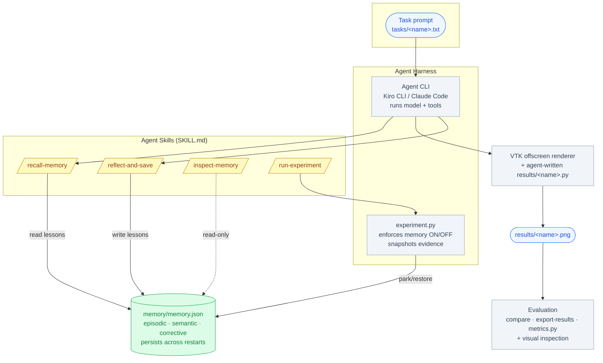
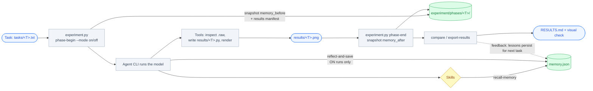
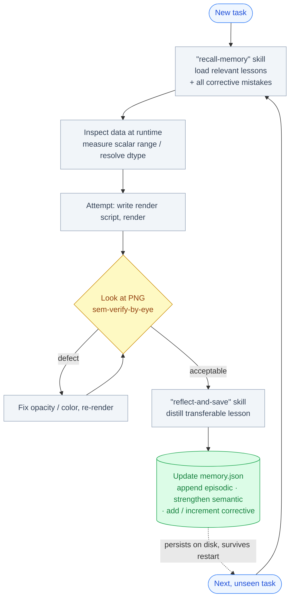
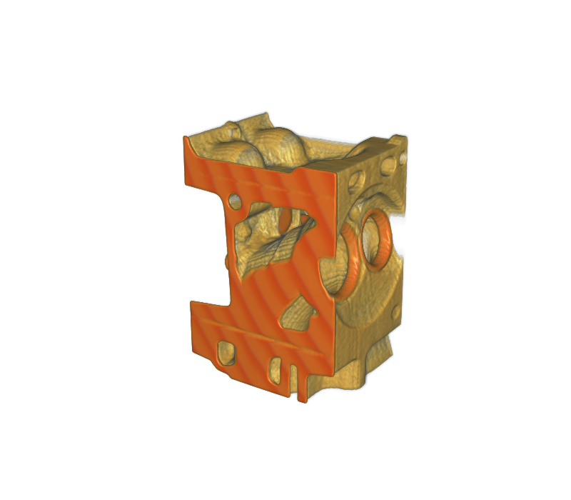
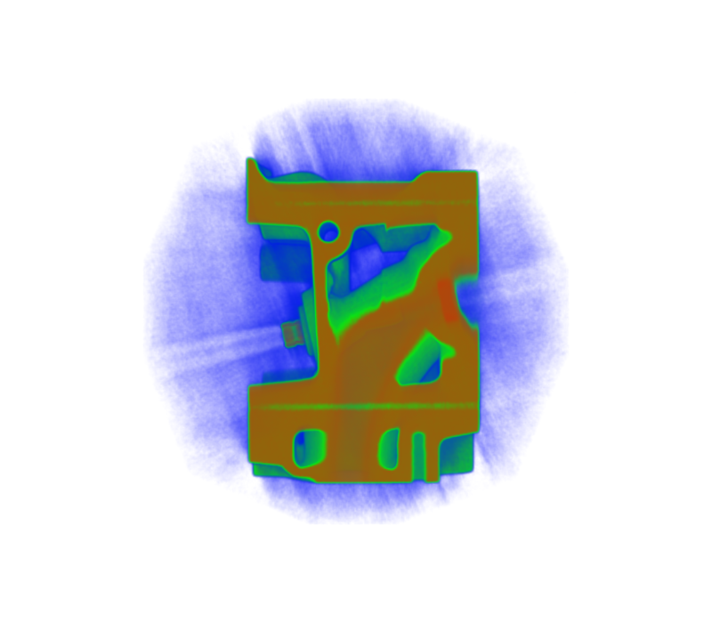
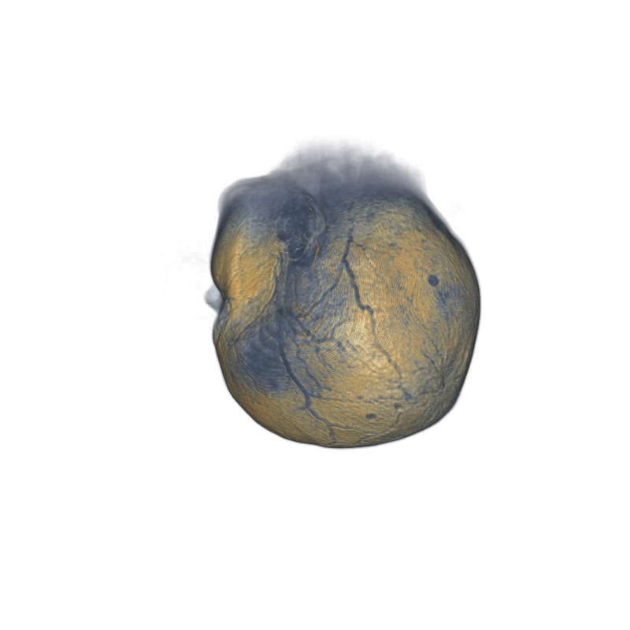
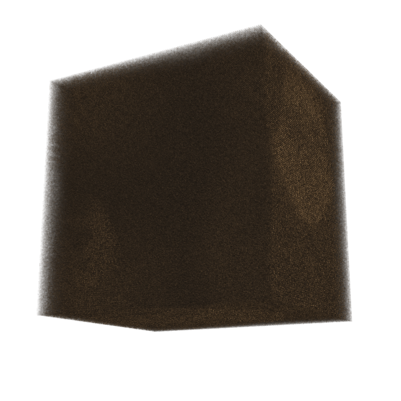

# ParaView Visualization Agent with Persistent Skill Memory

**A scientific-visualization agent that learns across tasks — it writes down what it learned rendering one volume, then recalls those lessons to render a new, unseen volume without repeating the same mistakes.**


> **What makes it "self-learning":** the memory is a plain JSON **file on disk**, so lessons
> learned in one session survive a full process restart and influence future runs. This is
> cross-task, persistent, in-context memory — **not** model fine-tuning. The precise mechanism,
> its evidence, and its limits are documented in [How the Agent Learns from Experience](#how-the-agent-learns-from-experience).

---

## Table of Contents

- [Demo and Artifacts](#demo-and-artifacts)
- [The Problem and Research Objective](#the-problem-and-research-objective)
- [Key Features and Engineering Highlights](#key-features-and-engineering-highlights)
- [System Architecture](#system-architecture)
- [Agent Harness: Architecture and Orchestration](#agent-harness-architecture-and-orchestration)
- [Agent Skills: Design and Execution](#agent-skills-design-and-execution)
- [How the Agent Learns from Experience](#how-the-agent-learns-from-experience)
- [Experiment Design, Execution, and Results](#experiment-design-execution-and-results)
- [Reproduce the Experiment](#reproduce-the-experiment)
- [Repository Structure](#repository-structure)
- [Technical Trade-offs and Limitations](#technical-trade-offs-and-limitations)
- [Acknowledgments and Data Attribution](#acknowledgments-and-data-attribution)
- [License and Contributions](#license-and-contributions)

---

## Demo and Artifacts

This project has no hosted web demo; the "demo" is the reproducible experiment and its committed
artifacts. The strongest evidence lives in the repository itself:

- **Rendered comparisons** — `results/engine_on.png` vs `results/engine_off.png`,
  `results/mri_woman_on.png` vs `results/mri_woman_off.png`.
- **Auto-generated results report** — [`RESULTS.md`](RESULTS.md).
- **Per-run evidence** — `experiment/phases/<name>/` holds the memory snapshot before and after
  each run plus a transcript.
- **The persistent memory store** — [`memory/memory.json`](memory/memory.json).

> There is no video or blog link yet. If one is added later, it belongs in this section.

---

## The Problem and Research Objective

**Problem.** Volume rendering a raw scalar field is finicky: pick the wrong opacity ramp and the
subject drowns in a "haze" of low-value background voxels; misread a headerless file's data type
and the volume scrambles into noise. A human expert learns these lessons once and reuses them.
Most LLM agents, by contrast, treat every task as brand new and rediscover the same fixes from
scratch each time.

**Research question.** *If an agent persists the transferable lessons it learns on one
visualization task, does recalling them measurably improve its behaviour on a different, unseen
dataset — specifically, does it avoid repeating mistakes it has made before?*

**Hypothesis.** An agent that (a) stores **range-relative procedures** rather than dataset-specific
constants, and (b) always inspects a dataset at runtime before acting, will transfer its lessons
across datasets, modalities, and data types — producing a correct render on the first attempt where
a memoryless (cold) agent reproduces a known defect.

**What a successful result looks like.** Given the *same* task prompt, the **memory-ON** run avoids a
defect (haze, or a dtype misread) that the **memory-OFF (cold)** run makes — and the difference is
visible in the two output images and traceable to a specific lesson in `memory/memory.json`.

---

## Key Features and Engineering Highlights

| Capability | How it is implemented | Verified evidence |
|---|---|---|
| **Persistent cross-task memory** | A JSON file `memory/memory.json` with three arrays: `episodic`, `semantic`, `corrective`. | File grows across runs: `memory_before.json` vs `memory_after.json` snapshots per phase. |
| **Three-tier memory model** | Episodic (what happened), semantic (reusable rule), corrective (mistake→fix). | 3 episodic / 5 semantic / 3 corrective in the committed store. |
| **Transferable, not memorized** | Semantic rules are stored as *fractions of a measured scalar range*, never absolute values. | `sem-range-relative-tf` rule; the `reflect-and-save` curation rules enforce this. |
| **Genuinely-cold control** | A Python harness parks the real memory out of reach and presents an empty store for OFF runs. | `experiment.py phase-begin --mode off` → `experiment/memory_off_backup.json`. |
| **Deterministic experiment harness** | `experiment.py` owns phase bookkeeping, snapshots, and the comparison table. | All subcommands run on Python 3.14 / VTK 9.7.1 (see [Reproduce](#reproduce-the-experiment)). |
| **Agent-agnostic skills** | Four `SKILL.md` prompt-skills run under Kiro CLI *or* Claude Code unchanged. | `.kiro/skills/*/SKILL.md`, YAML frontmatter + `$ARGUMENTS`. |
| **Headless rendering** | VTK offscreen volume ray-casting, CPU-capable, no GPU required. | `smoke_test.py` → `RENDER OK (vtk 9.7.1)`. |

**Technology stack:** Python 3.9+ · [VTK](https://vtk.org/) ≥ 9.3 · NumPy · an agent CLI that reads
`SKILL.md` skills ([Kiro CLI](https://github.com/aws/kiro-cli) or
[Claude Code](https://docs.claude.com/en/docs/claude-code)). **No external APIs, cloud services, or
credentials are required.**

---

## System Architecture

This project is **not** a long-running autonomous program. It is a set of components an external
agent CLI drives. Four parts interact:

1. **Agent Harness** — the agent CLI (Kiro CLI or Claude Code) *plus* the deterministic Python
   bookkeeping script `experiment.py`. The CLI runs the model and tools; `experiment.py` enforces
   the memory state and captures evidence.
2. **Agent Skills** — four `SKILL.md` files that tell the agent *when and how* to recall memory,
   reflect, inspect, and run the experiment.
3. **Evaluation System** — `experiment.py compare` / `export-results` + `metrics.py`, plus the human
   eye comparing the two PNGs.
4. **Learning Mechanism** — the `reflect-and-save` skill writing distilled lessons back into
   `memory/memory.json`, which `recall-memory` reads on the next task.



**What is automated vs manual.** The agent CLI automates model calls, tool use, writing the render
script, and reading/writing memory. The *human operator* drives the session (issues the slash
commands, pastes the session transcript into `experiment/phases/<name>/transcript.txt` for the
heuristic metrics, and compares the two PNGs by eye). `experiment.py` automates the ON/OFF
bookkeeping so the control is honest. **No step depends on an external network service.**

---

## Agent Harness: Architecture and Orchestration

### A. What the harness does

The "harness" has two layers, and it is important to separate what each provides:

| Layer | Provided by | Responsibilities |
|---|---|---|
| **Model / tool runtime** | The agent CLI (Kiro CLI or Claude Code) — *not* code in this repo | Agent initialization, model configuration, system instructions, **loading and selecting skills**, tool registration/execution (shell, file write/edit), conversation/context management, the execution loop, retry/termination, logging. |
| **Experiment orchestration** | `experiment.py` — *written for this project* | Enforcing memory ON/OFF, archiving prior runs, snapshotting memory and results manifests per phase, restoring parked memory, producing the comparison table and `RESULTS.md`. |

Everything in the left column is a capability of the underlying CLI framework. Everything in the
right column is the project-specific bookkeeping that makes the experiment reproducible and the OFF
run genuinely cold. The repository deliberately does **not** reimplement an agent loop; it rides on
the CLI's loop and adds the controls a prompt-only skill cannot guarantee on its own (this rationale
is stated in the module docstring of [`experiment.py`](experiment.py)).

### B. Harness execution lifecycle



The harness state model (verified in `experiment.py`):

- `reset` → empties `memory/memory.json`, archives any prior `experiment/` tree with a timestamp.
- `phase-begin --name X --mode on|off` → writes `mode.txt`; for **off** it moves the live store to
  `experiment/memory_off_backup.json` and writes an empty store so the agent *cannot* read or
  pollute real memory; snapshots `memory_before.json` and `results_before.txt`.
- `phase-end --name X` → snapshots `memory_after.json` and `results_manifest.txt`; for **off** it
  restores the parked memory.
- `compare --on A --off B` and `export-results` → produce the markdown comparison.
- `status` → prints memory counts and auto-discovers `B_<dataset>_on`/`B_<dataset>_off` pairs.

### C. Why this harness

A `SKILL.md` prompt alone cannot *guarantee* that a "memory OFF" run is genuinely cold, nor can it
reliably snapshot artifacts between phases — a model told "pretend you have no memory" can still peek
at the file. Delegating that bookkeeping to a tiny deterministic Python script makes the control
trustworthy and the whole experiment reproducible from the shell, independent of which model or CLI
is driving the skills. Reusing the CLI's own agent loop (rather than building a custom one) keeps the
footprint small and lets the same skills run under either Kiro CLI or Claude Code unchanged.

### D. Harness ↔ skills ↔ evaluation ↔ learning

- **Agent Harness** executes the agent and enforces experiment state.
- **Agent Skills** are the instructions that shape *what* the agent does at each step.
- **Evaluation** (`compare`, `export-results`, `metrics.py`, and the human eye) measures the outcome.
- **Learning** is the `reflect-and-save` → `memory.json` → `recall-memory` cycle that carries lessons
  forward.

These four meet at `memory/memory.json`: the harness guards it, skills read/write it, evaluation
reads its growth as evidence, and learning is literally the act of appending to it.

---

## Agent Skills: Design and Execution

### A. Why agent skills?

The useful behaviour here is **procedural and reusable**: *always inspect before you render; build
the transfer function from the measured range; recall mistakes and avoid them; reflect and write down
what transferred.* Encoding that as discrete, named skills — rather than one giant system prompt or a
hardcoded Python pipeline — buys three things that this project actually uses:

- **Separation of responsibilities** — recall, reflect, inspect, and orchestrate are independent
  concerns with independent instructions, so each can be reasoned about and edited alone.
- **Selective context** — only the skill(s) relevant to the current step load their instructions into
  context; the full procedure is not permanently resident in the prompt.
- **Reusability across datasets and across CLIs** — the same four files drive bonsai, engine,
  mri_woman, or any new `data/<name>.raw` + `tasks/<name>.txt`, under Kiro CLI or Claude Code.

### B. Skill architecture

Each skill is a `SKILL.md` file: **YAML frontmatter** (`name`, `description`) followed by a Markdown
body that is the instruction set. The body references the invoking argument as `$ARGUMENTS`.

```
.kiro/skills/
  recall-memory/SKILL.md
  reflect-and-save/SKILL.md
  inspect-memory/SKILL.md
  run-experiment/SKILL.md
```

- **Discovery & selection** — the agent CLI indexes the `SKILL.md` files and exposes each as a slash
  command. The `description` frontmatter is what the CLI uses to decide when a skill is relevant.
- **Activation** — invoking `/recall-memory engine volume` loads that skill's Markdown body into
  context with `$ARGUMENTS` = `engine volume`, and the agent follows those instructions.
- **Interaction with tools** — skills instruct the agent to use the CLI's shell and file tools
  (inspect the `.raw` bytes, write `results/<name>.py`, run the render) and to read/write
  `memory/memory.json`. Results return to the agent as normal tool output.
- **Progressive disclosure** — only the active skill's instructions enter context, and `recall-memory`
  further narrows memory to *relevant* entries (match `dataset_type` + keywords, always include all
  `corrective`). This keeps context small as memory grows.

### C. The skills

| Skill | Responsibility | Trigger / Invocation | Tools used | Expected output |
|---|---|---|---|---|
| [`recall-memory`](.kiro/skills/recall-memory/SKILL.md) | Load relevant past lessons and require runtime inspection before building a transfer function | `/recall-memory <task>` at the **start** of a task | Read `memory/memory.json` | A **"Lessons I'm applying"** section (semantic rules, corrective mistakes, episodic reference params); `"No prior memory — solving from scratch"` if empty |
| [`reflect-and-save`](.kiro/skills/reflect-and-save/SKILL.md) | Distill lessons from the finished task and append/strengthen them, keeping only transferable procedures | `/reflect-and-save <task>` at the **end** of a task | Read + write `memory/memory.json` | Updated store: one new episodic record; new or strengthened semantic rule; new or strengthened corrective record |
| [`inspect-memory`](.kiro/skills/inspect-memory/SKILL.md) | Human-readable, read-only dump of the store | `/inspect-memory` anytime | Read `memory/memory.json` | A printed summary of episodic/semantic/corrective entries (no file changes) |
| [`run-experiment`](.kiro/skills/run-experiment/SKILL.md) | Orchestrate the full memory ON-vs-OFF A/B test for any dataset | `/run-experiment <dataset>` (default `engine`) | Shell → `experiment.py` subcommands; the other three skills; VTK render | ON and OFF renders, phase snapshots, and a regenerated `RESULTS.md` |

### D. A representative skill walk-through

Rendering `engine` **with memory ON** (traced from
[`experiment/phases/B_engine_on/transcript.txt`](experiment/phases/B_engine_on/transcript.txt)):

1. `/recall-memory engine volume rendering` reads the store and prints the lessons from the earlier
   bonsai run — including `sem-background-cutoff` / `cor-haze` ("hold opacity 0 below a cutoff
   fraction to kill haze").
2. The agent inspects `engine.raw` at runtime (256×256×128 uint8, range `[0,255]`), as the recall
   skill requires.
3. It writes `results/engine.py` with a range-relative transfer function **and applies the background
   cutoff from the start** — the haze mistake is pre-empted, not rediscovered.
4. It renders, looks at the PNG (no haze), makes one opacity tweak to make the shell fainter, and
   finishes.
5. `/reflect-and-save engine` adds `ep-engine-1`, strengthens the shared semantic rules
   (confidence 0.8→0.9, evidence `+= ep-engine-1`), adds `sem-faint-shell-opaque-core`, and leaves
   `cor-haze.times_seen` at `1` because the mistake **did not recur**.

### E. Skill design decisions and trade-offs

- **Boundaries by lifecycle moment.** Recall (start) and reflect (end) are split because they run at
  different times and must not contaminate each other — reflect must never run on a cold OFF control.
- **A hard "inspect first" guardrail inside `recall-memory`.** The biggest risk of a memory system is
  copying a stale constant onto a dataset where it is wrong. The recall skill explicitly states that
  recalled lessons are *procedures to apply, not constants to copy*, and forbids assuming a fixed
  range/dtype — this is what makes transfer safe across the uint8→uint16 modality change.
- **Curation rules in `reflect-and-save` bound memory growth.** It must strengthen (bump
  `confidence`, append `evidence_ids`, increment `times_seen`) rather than duplicate, store one–two
  sentence lessons, and never store transcripts, full scripts, constants, or secrets.
- **Validation is by experiment, not unit tests.** Skills are "tested" by running the ON/OFF A/B and
  checking whether the recalled lesson actually changed behaviour (see
  [Experiment Results](#experiment-design-execution-and-results)). There is no automated skill test
  suite — a documented limitation.

---

## How the Agent Learns from Experience

### A. What "self-learning" means here — precisely

Learning in this project is **persistent in-context memory augmentation**, implemented as four
mechanisms, all of which are visible in the artifacts:

- **Storing and retrieving previous experiences** — episodic records of past attempts.
- **Distilling and refining reusable procedures** — semantic rules, strengthened over runs.
- **Reflecting on failures** — corrective records (mistake → fix).
- **Updating a persistent memory file** — `memory/memory.json`, read back on the next task.

**It is explicitly NOT model fine-tuning or any parameter update.** The model's weights never change.
What changes is a JSON file that is fed back into the model's context on the next task. That is the
honest, exact description of the mechanism.

### B. The learning loop



### C. The mechanism, technically

| Question | Answer (grounded in the implementation) |
|---|---|
| **What triggers a learning event?** | The operator invoking `/reflect-and-save` at the end of an ON task. |
| **What feedback does the agent get?** | Its own rendered PNG (looked at via `sem-verify-by-eye`) and the task goal — a self-generated signal, not an external scorer. |
| **How are failures interpreted?** | A visible defect (haze, opaque shell, scrambled volume) becomes a corrective `{mistake, fix}` record. |
| **What exactly gets updated?** | `memory/memory.json`: one new episodic record; a new or strengthened semantic rule (bump `confidence`, append `evidence_ids`); a new or incremented corrective record (`times_seen`). |
| **Automatic or human-approved?** | Human-driven — the operator issues the skill and the agent writes the file. There is no autonomous write. |
| **Where are improvements stored? Persistent?** | In `memory/memory.json` on disk — **yes, persistent across sessions and process restarts.** |
| **How is a mistake avoided next time?** | `recall-memory` always surfaces **all** corrective entries, so the agent re-checks every known mistake regardless of dataset. |
| **How are bad updates rejected/rolled back?** | Only partially: `reflect-and-save` curation forbids duplicates and constants, and `experiment.py reset` can wipe the store. There is **no automated regression check or rollback** — a documented limitation. |
| **How is improvement measured independently?** | By the OFF (cold) control, which never sees the learned memory, on the *same* task. |

### D. A real learning example (bonsai → engine)

Traced end-to-end from the committed transcripts and memory snapshots:

| Stage | What happened | Evidence |
|---|---|---|
| **Initial task** | Render `bonsai.raw`; memory starts **empty**. | `A_bonsai_on/memory_before.json` = `{[],[],[]}` |
| **First attempt** | Gave low-value voxels opacity → a speckle **haze** cloud fogged the subject. | `A_bonsai_on/transcript.txt` |
| **Feedback** | Looked at the PNG, saw the haze (self-evaluation). | same transcript |
| **Fix + save** | Raised the background cutoff; `reflect-and-save` wrote `cor-haze` + `sem-background-cutoff`. | `A_bonsai_on/memory_after.json` (1/3/2) |
| **Second task** | Render `engine.raw` (different dataset). `recall-memory` surfaced `cor-haze`. | `B_engine_on/transcript.txt` |
| **Measured outcome** | Applied the cutoff **preemptively** → **no haze on the first render**; `cor-haze.times_seen` stayed `1` (mistake did not recur). | memory store: `cor-haze.times_seen = 1` |
| **Cold control** | `engine` rendered **OFF** reproduced the exact haze. | `B_engine_off/transcript.txt`, `results/engine_off.png` |

**Before:** haze had to be discovered and fixed. **After:** the lesson transferred to a new dataset
and the defect never appeared. The hard evidence is the image contrast (`engine_on.png` vs
`engine_off.png`) plus `cor-haze.times_seen` not incrementing.

### E. Results across learning iterations

| Iteration | Memory state entering the run | Change introduced by the run | Outcome |
|---|---|---|---|
| 1 — bonsai (ON) | empty (0/0/0) | +1 episodic, +3 semantic, +2 corrective (incl. `cor-haze`) | Learned the haze fix the hard way |
| 2 — engine (ON) | 2/4/2 | +1 episodic, +`sem-faint-shell-opaque-core`; strengthened shared rules | **Haze avoided first try** on a new dataset |
| 3 — mri_woman (ON) | 2/4/2 | +1 episodic, +`sem-resolve-headerless-by-inspection`; strengthened rules → **3/5/3** | Lessons transferred across **modality + dtype** (uint8→uint16) |

Generalization note: the mri_woman run is the strongest evidence of **generalization rather than
memorization** — none of the stored rules mention MRI or uint16, yet the range-relative + cutoff +
inspect-first procedures still produced a clean first render, while the cold OFF run misread the dtype
and produced a scrambled brown cube.

### F. Limitations of the self-learning

- **Self-generated feedback.** The "evaluator" is the agent looking at its own PNG; a wrong
  self-assessment would store a wrong lesson. There is no independent automated scorer.
- **No rollback / regression gate.** Curation prevents duplicates and constants, but nothing
  automatically detects or reverts a harmful lesson.
- **Unbounded-growth risk is only partially mitigated.** Strengthening-over-duplicating and relevance
  filtering help, but memory still grows and could eventually bloat context.
- **Single run per condition.** Representative demonstration, not a statistical benchmark.
- **Transcripts are human-pasted summaries**, so the transcript-derived metrics are heuristic (see
  below), not machine-captured logs.

---

## Experiment Design, Execution, and Results

### A. Research problem and hypothesis

See [The Problem and Research Objective](#the-problem-and-research-objective). In short: does persisted,
transferable memory make an agent correct-on-first-try on an unseen volume where a cold agent
reproduces a known mistake?

### B. Experimental design

- **Baseline (control):** memory **OFF** — the harness parks real memory and presents an empty store;
  the agent solves the task cold with no recall and no reflect.
- **Experimental:** memory **ON** — the agent recalls lessons learned on earlier datasets, applies
  them, and reflects afterward.
- **Datasets / tasks:** `tasks/bonsai.txt`, `tasks/engine.txt`, `tasks/mri_woman.txt` over
  `data/*.raw`. The ON and OFF runs use the **identical** task prompt; the only difference is memory
  availability.
- **Independent variable:** memory availability (ON vs OFF). **Dependent variables:** presence of a
  known defect, render attempts, error/retry signals, and memory growth.
- **Evaluation metrics:** (1) **primary, qualitative** — does the ON image avoid a defect the OFF
  image shows? (2) **secondary, heuristic** — regex counts over the transcript (`experiment.py
  compare`, `metrics.py`) and (3) memory-store growth.
- **Trials:** one run per condition per dataset. **Success criterion:** ON avoids a defect OFF makes,
  traceable to a specific lesson. **Control:** the parked-memory mechanism guarantees OFF is cold.

### C. Execution workflow

**Task Input → Harness sets memory state → Skill selection (recall) → Inspect + render (tools) →
Output PNG → Self-evaluation (look) → Reflect/save → Learning persisted → Next dataset.** Fully
diagrammed in [Harness execution lifecycle](#b-harness-execution-lifecycle) and
[The learning loop](#b-the-learning-loop).

### D. Results

Primary evidence (open the images in `results/`):

The clearest signal is the image contrast. In each pair, both runs received the **identical** task
prompt; the only difference is whether prior memory was available. The **memory-ON** render (left)
avoids a defect that the cold **memory-OFF** render (right) makes.

**`engine` — memory ON vs OFF (cold)**

| Memory ON (clean) | Memory OFF (cold) |
|:---:|:---:|
|  |  |
| Haze-free; faint gold shell, dense interior cavities read clearly. | **Blue background haze** fogs the volume; outer shell is a bright halo, not faint. |

**`mri_woman` — memory ON vs OFF (cold)**

| Memory ON (readable anatomy) | Memory OFF (cold) |
|:---:|:---:|
|  |  |
| Dtype resolved by inspection; translucent cool soft tissue, dense skull/sutures in warm gold. | **dtype misread** (uint16 read as uint8) scrambles the volume into a featureless brown cube, plus haze. |

> The two PNGs per dataset are the hard, reproducible evidence. For the full auto-generated report —
> every dataset pair, the metric tables, and the current memory store — see **[`RESULTS.md`](RESULTS.md)**
> (regenerated by `python experiment.py export-results`).

Secondary evidence — memory growth and transcript heuristics, as auto-written to
[`RESULTS.md`](RESULTS.md) by `experiment.py export-results`:

| Dataset | Render invocations ON | Render invocations OFF | Error/retry signals ON | Error/retry signals OFF | Memory after ON (ep/sem/cor) | Memory after OFF |
|---|---|---|---|---|---|---|
| engine | 3 | 3 | 0 | 0 | 2/4/2 | 0/0/0 |
| mri_woman | 2 | 1 | 2 | 1 | 3/5/3 | 0/0/0 |

> **Honest caveat on the heuristic counts.** `experiment.py compare` also reports a "tool calls
> (steps proxy)" row that, for engine, reads **ON = 12 vs OFF = 5**. This does **not** mean memory
> made the agent slower — the ON transcript is simply more detailed (it narrates recalled lessons),
> and the metric is a naive regex count over human-pasted transcript text. The transcript-derived
> numbers are weak proxies; the **reliable evidence is the image contrast and the persisted memory
> diff.** The code and `RESULTS.md` both state this limitation explicitly.

### E. Findings

- **What improved:** the ON agent avoided a *known* defect on an unseen dataset — haze on `engine`,
  and both a dtype misread and haze on `mri_woman` — producing a usable render on the first attempt.
- **What this suggests:** storing **procedures relative to a measured range** (not constants) plus a
  hard "inspect first" rule is what let the lessons transfer across dataset, modality, and data type.
- **What did not improve / did not change:** the heuristic step-count proxy is uninformative (and
  looks worse for ON due to verbosity). No experiment "failed," but the evidence is a demonstration,
  not a statistically powered benchmark.
- **Unexpected behaviour:** the cold `mri_woman` OFF run failed *more severely* than expected (wrong
  dtype → scrambled cube), which sharpens the contrast but also shows how much the single
  `sem-resolve-headerless-by-inspection` rule was doing.

---

## Reproduce the Experiment

### Prerequisites

- **OS:** macOS or Linux (Windows works; use the noted PowerShell variants). Rendering is headless —
  **no GPU required.**
- **Python:** 3.9+ (verified on 3.14.5).
- **Agent CLI** that reads `SKILL.md` skills — either
  [Kiro CLI](https://github.com/aws/kiro-cli) (reads `.kiro/skills/`, shipped here) or
  [Claude Code](https://docs.claude.com/en/docs/claude-code) (reads `.claude/skills/`; see
  [below](#using-the-skills-under-claude-code)).
- Python packages in `requirements.txt`: `vtk>=9.3`, `numpy` (verified: VTK 9.7.1, NumPy 2.5.3).

### 1. Clone and set up the environment

```bash
git clone <this-repo-url>
cd ParaView-Visualization-Agent-with-Persistent-Skill-Memory

python3 -m venv .venv
source .venv/bin/activate            # Windows: .venv\Scripts\activate
pip install -r requirements.txt
```

### 2. Verify headless rendering (no dataset needed)

```bash
python smoke_test.py
```

Expected output:

```
RENDER OK  (vtk 9.7.1) -> smoke_test.png
```

If you see that line and a `smoke_test.png` appears, your environment can render volumes offscreen.

### 3. Environment variables and credentials

**None.** This project uses no external APIs, cloud services, model keys, or secrets — all rendering
and bookkeeping run locally. There is intentionally **no `.env.example`**; nothing needs configuring.

### 4. Get the datasets

The `.raw` volumes live in `data/` (headerless raw bytes — no embedded dimensions or dtype, which is
why each task either states the layout or asks the agent to resolve it by inspection):

```
data/bonsai.raw       256 x 256 x 256, uint8        (16,777,216 bytes)
data/engine.raw       256 x 256 x 128, uint8        ( 8,388,608 bytes)
data/mri_woman.raw    256 x 256 x 109, uint16-LE    (14,286,848 bytes; resolved by inspection)
```

If `data/` is empty in your clone, place the three volumes at those paths. `bonsai` and `engine` are
classic open volume datasets; `mri_woman` is an MRI volume. These volumes are sourced from the
**SciVisAgentBench** dataset (`sci_volume_data`) — see
[Acknowledgments and Data Attribution](#acknowledgments-and-data-attribution) for the source and
download command.

### 5. Initialize the harness and load the skills

Launch your agent CLI from the project root so the skills are discovered. In Kiro CLI, confirm with
`/context show` that `recall-memory`, `reflect-and-save`, `inspect-memory`, and `run-experiment` are
listed. Inspect the harness and current memory anytime:

```bash
python experiment.py status
```

### 6. Run a single experiment (one dataset, ON vs OFF)

From the agent CLI at the project root:

```
/run-experiment engine
```

The `run-experiment` skill orchestrates (issuing the `experiment.py` subcommands for you):

1. **Preconditions + status** — checks `data/engine.raw` and `tasks/engine.txt`, prints memory counts.
2. **Phase ON** — `/recall-memory`, inspect → render → look → fix, `/reflect-and-save`, save
   `results/engine_on.png`; paste the session transcript to
   `experiment/phases/B_engine_on/transcript.txt`.
3. **Phase OFF (cold)** — solve the identical task with **no** recall/reflect (memory parked by the
   harness), save `results/engine_off.png`; paste the transcript to
   `experiment/phases/B_engine_off/transcript.txt`.
4. **Compare + export** — regenerate `RESULTS.md`.

### 7. Run the full sequence (demonstrate cross-task transfer)

To reproduce the learning story from an empty store:

```bash
python experiment.py reset                 # empty memory, archive any prior run
```

Then, in the agent CLI, run the datasets in order so later tasks inherit earlier lessons:

```
/run-experiment bonsai
/run-experiment engine
/run-experiment mri_woman
```

To prove persistence, **quit and relaunch the CLI between datasets** — the memory is a file on disk,
so recalled lessons survive the restart.

### 8. Evaluate and reproduce the metrics

```bash
# markdown comparison for one pair
python experiment.py compare --on B_engine_on --off B_engine_off

# regenerate RESULTS.md across all discovered ON/OFF pairs
python experiment.py export-results

# optional: heuristic table from a single saved transcript
python metrics.py --label "engine ON"  --transcript experiment/phases/B_engine_on/transcript.txt
python metrics.py --label "engine OFF" --transcript experiment/phases/B_engine_off/transcript.txt
```

### 9. Expected outputs and where they land

| Artifact | Location |
|---|---|
| Per-dataset renders | `results/<name>_on.png`, `results/<name>_off.png` (+ the agent-written `results/<name>.py`) |
| Phase evidence | `experiment/phases/<name>/{mode,memory_before,memory_after,results_manifest,transcript}` |
| Persistent memory | `memory/memory.json` |
| Results report | `RESULTS.md` |

### Reset to a clean state

```bash
python experiment.py reset     # empty memory + archive the experiment tree
# or wipe generated renders:
rm -rf results/*
```

### Using the skills under Claude Code

The skills are plain `SKILL.md` files (YAML frontmatter + Markdown + `$ARGUMENTS`), the format Claude
Code expects under `.claude/skills/`. Mirror them once:

```bash
mkdir -p .claude/skills
cp -R .kiro/skills/* .claude/skills/        # Windows PowerShell: Copy-Item -Recurse .kiro\skills\* .claude\skills\
```

Everything else (`memory/memory.json`, `experiment.py`, `tasks/`, `data/`, `results/`) is
agent-agnostic, so the experiment behaves identically under either CLI.

### Reproducibility caveats (what *cannot* be fully automated)

- **The model is non-deterministic.** The render script the agent writes will vary run to run; there
  is no fixed random seed because the "randomness" is the LLM's generation, not a seeded RNG.
- **A human drives the session and pastes the transcript.** The ON/OFF *harness bookkeeping* is fully
  deterministic and scriptable, but issuing the slash commands and saving the transcript are manual.
- **Results depend on the model behind your CLI.** The committed artifacts were produced with the
  skills as written; a different model may need different wording to achieve the same transfer.

---

## Repository Structure

```
ParaView-Visualization-Agent-with-Persistent-Skill-Memory/
├── .kiro/
│   └── skills/
│       ├── recall-memory/SKILL.md       # load relevant lessons at task start (+ require runtime inspection)
│       ├── reflect-and-save/SKILL.md    # write transferable lessons at task end
│       ├── inspect-memory/SKILL.md      # read-only pretty-print of the store
│       └── run-experiment/SKILL.md      # orchestrate the memory ON-vs-OFF A/B for any dataset
├── memory/
│   └── memory.json                      # the persistent store (episodic / semantic / corrective)
├── tasks/
│   ├── bonsai.txt                       # goal-only task prompts
│   ├── engine.txt
│   └── mri_woman.txt
├── data/
│   ├── bonsai.raw                       # headerless raw volumes
│   ├── engine.raw
│   └── mri_woman.raw
├── experiment/
│   └── phases/
│       ├── A_bonsai_on/                 # per-run evidence (one dir per phase)
│       │   ├── mode.txt                 #   "on" or "off"
│       │   ├── memory_before.json       #   memory snapshot entering the phase
│       │   ├── memory_after.json        #   memory snapshot after the phase
│       │   ├── results_before.txt       #   results/ manifest before the run
│       │   ├── results_manifest.txt     #   results/ manifest after the run
│       │   └── transcript.txt           #   human-pasted session transcript
│       ├── B_engine_on/
│       ├── B_engine_off/
│       ├── B_mri_woman_on/
│       └── B_mri_woman_off/
├── results/                             # agent-written render scripts + PNGs
│   ├── bonsai.py                        #   bonsai (single Phase-A run, unsuffixed)
│   ├── bonsai.png
│   ├── engine.py                        #   engine ON render script (see naming note below)
│   ├── engine_on.png
│   ├── engine_off.py
│   ├── engine_off.png
│   ├── mri_woman_on.py
│   ├── mri_woman_on.png
│   ├── mri_woman_off.py
│   └── mri_woman_off.png
├── experiment.py                        # deterministic harness: enforces ON/OFF, snapshots, compare, export
├── metrics.py                           # heuristic transcript -> before/after table
├── smoke_test.py                        # headless-render environment check (no data needed)
├── RESULTS.md                           # auto-generated ON-vs-OFF comparison (one section per dataset pair)
├── requirements.txt                     # vtk>=9.3, numpy
├── README.md
└── LICENSE                              # MIT
```

> **Naming note (honest):** the `engine` ON render script is committed as `results/engine.py` rather
> than `results/engine_on.py`; the ON image is `results/engine_on.png`. `bonsai` was a single Phase-A
> run, so it has only unsuffixed `bonsai.py` / `bonsai.png`. `mri_woman` has fully suffixed
> `_on`/`_off` scripts and images. This inconsistency is cosmetic and does not affect the experiment.

---

## Technical Trade-offs and Limitations

- **Prompt/memory learning, not fine-tuning.** The model never changes; a JSON file does. This is a
  deliberate, low-cost design — and the reason "learning" is bounded by what fits in context.
- **Self-evaluation, no external scorer.** Feedback is the agent viewing its own render. This keeps
  the loop simple and offline but means a wrong self-assessment could persist a wrong lesson.
- **No automated regression gate or rollback.** Curation rules reduce bad writes; they do not
  guarantee correctness. Mitigation today is manual review and `experiment.py reset`.
- **Heuristic transcript metrics.** The regex counts are weak proxies and can be misleading (see the
  caveat in Results). The image comparison and memory diff are the trustworthy signals.
- **Single trial per condition.** A demonstration of transfer, not a statistically powered benchmark.
- **Human-in-the-loop reproduction.** Harness bookkeeping is deterministic; the session itself is
  driven by a human and a non-deterministic model.
- **Future work:** an automated image-quality check to replace self-evaluation; a regression gate
  that rejects lessons that degrade a held-out task; machine-captured transcripts; and multiple
  trials per condition for statistics.

---

## Acknowledgments and Data Attribution

The volume datasets used in this project (`data/bonsai.raw`, `data/engine.raw`,
`data/mri_woman.raw`) come from the **SciVisAgentBench** dataset — specifically the
`sci_volume_data` collection published on Hugging Face. Full credit to the authors for
assembling and releasing this benchmark data.

- **Benchmark & code:** [KuangshiAi/SciVisAgentBench](https://github.com/KuangshiAi/SciVisAgentBench)
- **Dataset (Hugging Face):** [SciVisAgentBench/SciVisAgentBench-tasks](https://huggingface.co/datasets/SciVisAgentBench/SciVisAgentBench-tasks)
  (the volumes live under the `sci_volume_data/` folder)

The datasets can be downloaded with the Hugging Face CLI:

```bash
pip install huggingface_hub
hf download SciVisAgentBench/SciVisAgentBench-tasks \
  --repo-type dataset \
  --local-dir ./SciVisAgentBench-tasks
# then copy the required volumes from SciVisAgentBench-tasks/sci_volume_data/ into data/
```

This project is an independent experiment that *uses* those volumes; it is not affiliated with
or endorsed by the SciVisAgentBench authors. Please consult the
[SciVisAgentBench license](https://github.com/KuangshiAi/SciVisAgentBench/blob/main/LICENSE) for
the terms governing the data.

---

## License and Contributions

Licensed under the [MIT License](LICENSE) — © 2026 RamyaLakshmi KS.
